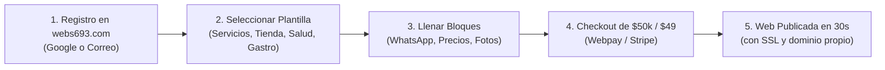
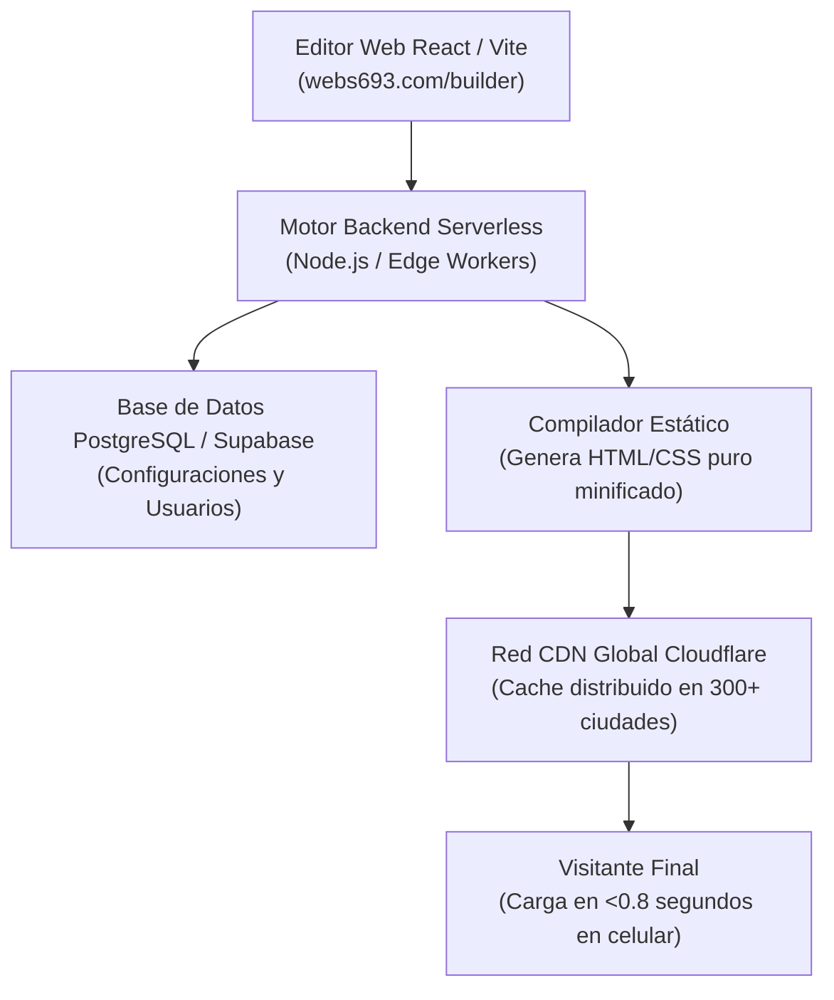

# 🚀 WEBS693.COM — SaaS Global de Sitios Web de Pago Único
**Un producto spin-off de UNIVERSO693 SpA**  
*Documento de Arquitectura, Modelo de Negocio y Hoja de Ruta Comercial.*

---

## 🌍 1. VISIÓN DEL PRODUCTO
**Webs693.com** es una plataforma SaaS global de creación rápida de sitios web y landing pages para profesionales, emprendedores, pequeños comercios y creadores de contenido de todo el mundo.

Su propuesta de valor destruye el modelo abusivo de suscripciones mensuales de Wix, Squarespace y Shopify:
> **«Crea tu sitio web profesional de alta velocidad en 5 minutos. Paga una sola vez ($50.000 CLP / $49 USD) y ten tu web para siempre, sin cobros mensuales forzosos.»**

---

## 💰 2. MODELO DE NEGOCIO Y ECONOMÍA UNITARIA

### Estructura de Precios Internacional:
| Mercado | Precio de Creación (Pago Único) | Renovación Anual de Dominio / Nube |
| :--- | :---: | :---: |
| **Chile (CLP)** | **$50.000 CLP** | **$10.000 CLP / año** |
| **Latinoamérica / USA / Europa (USD)** | **$49 USD** | **$12 USD / año** |

### Proyección de Ingresos:
* **Margen Bruto por Venta:** **>97%**.  
  *El alojamiento de un sitio web ultraligero y estático en redes globales (Cloudflare Pages / Vercel Edge) tiene un costo de infraestructura de ~$0.001 USD al mes.*
* **Escala a 1.000 sitios:**
  - Facturación inicial (pago único): **$50.000.000 CLP** / **$49.000 USD**.
  - Ingreso pasivo recurrente anual: **$10.000.000 CLP / año** / **$12.000 USD / año**.
* **Escala a 10.000 sitios:**
  - Facturación inicial: **$500.000.000 CLP** (~$500k USD).
  - Ingreso pasivo recurrente: **$100.000.000 CLP / año** (~$100k USD anuales netos).

---

## 🧩 3. EXPERIENCIA DEL CLIENTE (MODULAR TIPO LEGO)
El usuario no necesita diseñar ni saber CSS. Construye su web activando bloques visuales intuitivos:

### Bloques Nativos Pre-armados:
1. **Hero de Alta Conversión:** Portada, titular, logo y botón de llamada o WhatsApp.
2. **Botón Flotante Inteligente:** WhatsApp directo con mensaje pre-cargado configurable.
3. **Catálogo / Menú Interactivo:** Productos, platos o servicios con precio, foto y descripción.
4. **Galería de Fotos & Trabajos:** Arrastrar fotos desde el celular o conectar Instagram.
5. **Horarios & Ubicación:** Mapa interactivo de Google Maps y horarios de atención.
6. **Enlaces a Redes:** Instagram, TikTok, Facebook, LinkedIn, YouTube.
7. **Formulario de Contacto:** Notificaciones directas al correo y WhatsApp del dueño.

---

## ⚡ 4. ARQUITECTURA TÉCNICA (ALTA ESCALABILIDAD, COSTO CERO)

* **Zero-Server Maintenance:** No hay servidores que administrar ni parches de PHP como en WordPress.
* **Velocidad Extrema:** Cada web generada obtiene nota **98 a 100 en Google PageSpeed**.
* **Blindaje de Seguridad:** Certificados SSL automáticos TLS 1.3 y protección contra ataques DDoS incluida.

---

## 🔄 5. EL EMBUDO PERFECTO PARA UNIVERSO693
**Webs693.com** no solo es un negocio rentable por sí mismo; es el **canal de prospección más potente** para los servicios de alta ingeniería de UNIVERSO693:

1. El cliente entra pagando **$50.000 CLP** por su web inicial.
2. La web muestra un discreto sello en el footer:  
   *«Creado en webs693.com · Tecnología de ingeniería por UNIVERSO693 SpA»*.
3. Cuando ese negocio crece y necesita:
   - Facturación electrónica con el SII.
   - Agentes de IA cognitivos para WhatsApp.
   - Plataformas de software o apps a medida.
   - Migración cloud o campus virtuales.
4. **UNIVERSO693 ya es su proveedor de confianza**, convirtiendo clientes de $50k en contratos de $1.000.000 a $10.000.000 CLP.

---

## 📅 6. HOJA DE RUTA DE LANZAMIENTO (ROADMAP)

- [ ] **Fase 1: Asegurar Activos:** Registro del dominio `webs693.com` y reserva de redes.
- [ ] **Fase 2: Motor de Plantillas (MVP):** Editor visual con los 6 bloques base y generador estático.
- [ ] **Fase 3: Pasarelas de Pago:** Integración de Webpay Plus (Chile) y Stripe / PayPal (Global).
- [ ] **Fase 4: Lanzamiento Beta:** Ofrecer 50 cupos fundadores con garantía vitalicia a comunidades de emprendedores en Chile y LatAm.
